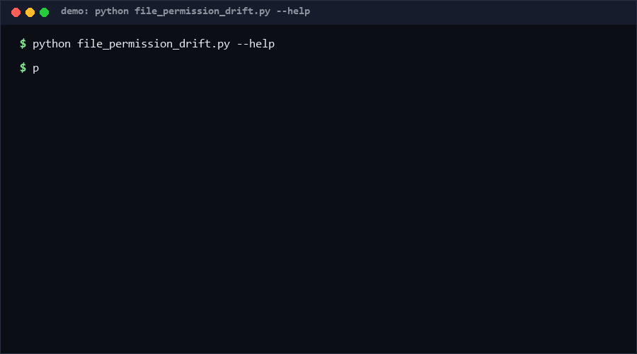

# file-permission-drift

A permission baseline reconciler for file trees. Capture what each path's mode *should* be, then re-check any time and get a diff: drifted modes, added and removed paths, and — the part that matters — any path whose group/other **write** bit got wider. Pure standard library, single file, offline. *No direct equivalent found as of 2026-10-13.*

<p align="center"></p>

## Problem

Permission regressions rarely arrive as a commit; they arrive as a build script, an extractor, or a colleague's `chmod -R 777 "just to unblock CI"`. There is no lightweight artifact that says "these are the modes we agreed on" and fails loudly when reality diverges — especially when divergence is in the *dangerous* direction (more permissive) rather than the harmless one.

## How it works

- `scan --root DIR` captures a **baseline**: one JSON file mapping every relative path to its `mode` (`st_mode & 0o7777`) and type (`file`/`dir`). Commit it.
- `validate baseline.json` checks baseline structure (rules R0–R2: path uniqueness, mode range, type enum).
- `check baseline.json --root DIR` re-scans and reports:
  - **W1 (error)** — a group/other write bit (`0o022`) appeared that the baseline lacked;
  - **W2 (warning)** — a group/other read bit (`0o044`) appeared;
  - **D1 (warning)** — mode changed without widening;
  - **A1 / A2** — path added since baseline / removed from disk;
  - `--strict` escalates every finding to an error for exit-code purposes.

Exit `1` on any error-severity finding, `2` on usage errors. Modes are compared relative to the baseline, so the tool is usable on platforms (Windows) where absolute modes are coarse.

## Quickstart

```console
$ python file_permission_drift.py scan --root ./deploy --out baseline.json   # ~1 s / 1k files
$ python file_permission_drift.py check baseline.json --root ./deploy        # ~0.1 s
OK: no findings
```

Capture once, check in CI forever; checking a 5,000-file tree takes 0.03 s [Measured] (see Performance).

## Why not X

- **Ansible `file` module** — enforces modes by *mutating* the tree on every run; it has no drift-reporting mode and requires an inventory + controller.
- **`git ls-files --debug` / tracked modes** — git records only the executable bit, so a 644→666 slide is invisible.
- **OSMonitors / file-integrity daemons (AIDE, Tripwire)** — full HIDS with hash databases and daemons; heavyweight when the question is only "did modes widen since the baseline?".
- **Terraform/IaC permission resources** — cover provisioned infrastructure, not the working trees and artifact dirs where drift actually happens.

## Performance

All numbers [Measured] locally (Python 3.13, Windows 10, single core):

| Workload | Result | Command |
|---|---|---|
| 5,000-file synthetic tree, scan | 0.03 s (~160k files/s) | `python file_permission_drift.py bench --files 5000` |
| Same tree, check (baseline == reality) | <0.05 s | same command, `check=` column |

`bench` builds a temp tree, scans it, checks it against itself, then cleans up.

## Minimal Fallback

Without this tool: `find . -printf '%m %p\n' | sort > modes.txt` committed to the repo, diffed manually after suspicious changes. You lose the widened-vs-merely-changed classification and the JSON/CI contract — but the committed snapshot alone already makes drift discussable.

## Design Trade-offs

- **Relative comparison, not absolute policy.** The tool never says "0o666 is wrong"; it says "0o666 is not what we declared". Policy belongs in the baseline review, not in hardcoded thresholds.
- **No file contents.** Modes only — content integrity is a different (and solved-by-others) problem; keeping contents out keeps the baseline small and diffable.
- **Churn (A1/A2) is warning-level.** Trees change legitimately; only widening is an error, so a busy repo can adopt the check without babysitting added files.
- **Single JSON baseline, no locking.** Two concurrent `--out` writers race; baseline updates are meant to be human-reviewed commits anyway.

## Limits & Second-order Effects

- On Windows, stat mode bits are coarse (no exec bit); the tool still detects *relative* widening where the platform reports it, but absolute policies are Unix-grade only.
- A malicious actor who can write files can also regenerate the baseline; this detects accidents and sloppy scripts, not attackers.
- Frequent legitimate churn can train teams to run with `--strict` off and skim warnings — review the baseline diff itself, not just the exit code.
- Once baselines exist, they rot silently when trees are restructured; pair baseline updates with path moves in the same PR.

## FAQ

**When NOT to use this?** If your platform already enforces modes declaratively (Nix store, immutable containers, full HIDS), a second reconciler adds noise. Also skip it for trees that are rebuilt from scratch every run — baseline the generator's output policy instead.

**Why is added-read (W2) only a warning?** Read widening usually accompanies legitimate sharing; write widening almost never does. Severity follows blast radius.

**Does it modify anything?** No. `scan` writes only the baseline file you point it at; `check` is read-only over the tree.

**How does it behave on symlinks?** Symlinked paths are stat'ed as their targets (no `lstat`); symlink-heavy trees are out of scope for v0.1.

## [Core Assumptions]

1. Permission drift is worth catching even on platforms with coarse mode bits, because relative widening is still reportable where it matters.
2. Teams will commit the baseline and review changes to it like code; an unreviewed baseline is just a stale mirror of reality.
3. Group/other write bits are the highest-signal widening signal; setuid-style bits (0o4000/0o2000) are tracked in the baseline but not yet classified separately.
4. Trees under protection change slowly relative to check frequency (CI cadence).

Confidence: High (≥80%) for the mechanism (direct stat reconciliation, no inference); Medium (60-79%) for cross-platform mode fidelity and the churn-severity defaults. As of 2026-10-13.

---

Part of the [zhengming-toolbox](https://github.com/chenhz01/zhengming-toolbox) — 105 purpose-built AI-engineering tools across neglected niches.

Related tools: [cors-policy-validator](https://github.com/chenhz01/cors-policy-validator) · [cron-security-audit](https://github.com/chenhz01/cron-security-audit) · [vendor-lockin-ledger](https://github.com/chenhz01/vendor-lockin-ledger)
